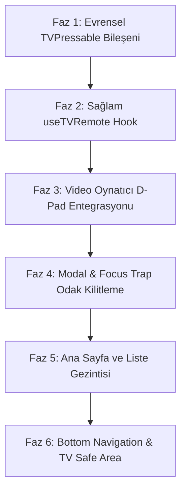

# StreamPulse - Android TV ve Kumanda (D-Pad) Entegrasyon Planı

Android TV ve kumanda entegrasyonu, standart mobil dokunmatik arayüzlerden farklı olarak **2D Uzamsal Odak (Spatial Navigation)** ve **Olay Tabanlı Donanım Tuş Dinleme (Hardware Key Events)** prensiplerine dayanır.

Bu doküman, mevcut mobil deneyimi ve performansı bozmadan tüm ekranları, yatay/dikey listeleri, video oynatıcıyı ve açılır modalları TV kumandasıyla (D-Pad) %100 uyumlu hale getirmek için hazırlanmış birleşik ve test edilmiş nihai uygulama planıdır.

---

## ⚠️ Kritik Mimari Tespitler ve React Native 0.86 Uyarıları

1. **`TVEventHandler` Sınıfı React Native 0.86'da Kaldırılmıştır:**
   - Standart React Native 0.86'da `import { TVEventHandler } from 'react-native'` çağrısı `undefined` döner ve `new TVEventHandler()` uygulamayı çökerterek (`TypeError: TVEventHandler is not a constructor`) hata verir.
   - **Çözüm:** Android çekirdeğindeki `ReactAndroidHWInputDeviceHelper.kt` sınıfı incelendiğinde, TV kumandası tuşlarının JavaScript tarafına `DeviceEventEmitter` üzerinden `"onHWKeyEvent"` adıyla iletildiği doğrulanmıştır. `useTVRemote` hook'umuz doğrudan bu kanalı dinler ve her tuşa tek seferlik (`ACTION_DOWN`, `eventKeyAction === 0`) tepki verir.

2. **Çoklu `autoFocus` Odak Savaşı:**
   - Ekranda birden fazla liste varken her listenin ilk kartına `autoFocus={index === 0}` verilmesi, odak yöneticisinin kararsız kalmasına yol açar.
   - **Çözüm:** Sayfa ilk açıldığında yalnızca tek bir birincil öğeye (örn. `HeroBanner`'daki "Hemen İzle" butonuna) `hasTVPreferredFocus={true}` verilir. Diğer bileşenler kullanıcı D-Pad ile üzerlerine yöneldiğinde odaklanır.

3. **FlatList Elemanlarının Ekrandan Düşmesi (`removeClippedSubviews`):**
   - Mobil sanallaştırma ekrandan çıkan kartları unmount ettiğinden, TV'de hızlıca sağa basıldığında odak boşluğa düşebilir.
   - **Çözüm:** TV ortamında yatay listelere `removeClippedSubviews={false}` tanımlanmalıdır.

4. **Mobil/Dokunmatik Uyumluluğu:**
   - `TVPressable` bileşeni `Platform.isTV` kontrolü yaparak dokunmatik cihazlarda standart davranışını korumalı, TV'ye özel ölçeklenme ve odak stillerini yalnızca TV ortamında devreye sokmalıdır.

---

## 🏗️ 6 Aşamalı Uygulama Mimarisi



---

### Faz 1: Evrensel Odaklanabilir Bileşen (`src/components/common/TVPressable.jsx`)

Hem mobilde dokunmatik hem de Android TV'de kumanda ile çalışan, `forwardRef` destekli ve zengin görsel odak (glow, ölçek, kenarlık) efektine sahip temel bileşen.

#### Uygulama Detayı:
- `focusable={!disabled}`
- `hasTVPreferredFocus={autoFocus && Platform.isTV}`
- Odaklanıldığında: `#E50914` veya tema rengi kenarlık, `scale: 1.05`, hafif elevation/glow
- `isFocused` ve `isPressed` durumlarını render prop (`children`) olarak sunabilme
- D-Pad yön yönlendirme props (`nextFocusUp`, `nextFocusDown`, `nextFocusLeft`, `nextFocusRight`)

```jsx
// src/components/common/TVPressable.jsx
import React, { forwardRef, useState } from "react";
import {
  Platform,
  Pressable,
  StyleSheet,
} from "react-native";

export const TVPressable = forwardRef(function TVPressable(
  {
    style,
    focusedStyle,
    pressedStyle,
    children,
    autoFocus = false,
    disabled = false,
    onFocus,
    onBlur,
    onPress,
    ...props
  },
  ref
) {
  const [isFocused, setIsFocused] = useState(false);

  const isTV = Platform.isTV;

  return (
    <Pressable
      ref={ref}
      focusable={!disabled}
      hasTVPreferredFocus={isTV && autoFocus}
      disabled={disabled}
      onFocus={(e) => {
        setIsFocused(true);
        onFocus?.(e);
      }}
      onBlur={(e) => {
        setIsFocused(false);
        onBlur?.(e);
      }}
      onPress={onPress}
      style={({ pressed }) => [
        style,
        isTV && isFocused && (focusedStyle || styles.defaultFocused),
        pressed && (pressedStyle || styles.defaultPressed),
      ]}
      {...props}
    >
      {typeof children === "function"
        ? children({ focused: isFocused, pressed: false })
        : children}
    </Pressable>
  );
});

const styles = StyleSheet.create({
  defaultFocused: {
    borderColor: "#E50914",
    borderWidth: 2,
    transform: [{ scale: 1.05 }],
    elevation: 8,
    shadowColor: "#E50914",
    shadowOffset: { width: 0, height: 4 },
    shadowOpacity: 0.5,
    shadowRadius: 8,
  },
  defaultPressed: {
    opacity: 0.85,
    transform: [{ scale: 0.98 }],
  },
});
```

---

### Faz 2: Çökmeyen Hibrit TV Olay Dinleyicisi (`src/hooks/useTVRemote.js`)

Android TV kumandasındaki D-Pad yönleri, OK/Center, Play, Pause, Rewind ve FastForward sinyallerini yakalayan kanca.

#### Desteklenen Tuş Olayları:
- `select` (D-Pad Center / OK / Enter)
- `playPause`, `play`, `pause`
- `left`, `right`, `up`, `down`
- `rewind`, `fastForward`
- `menu`, `info`

```javascript
// src/hooks/useTVRemote.js
import { useEffect, useRef } from "react";
import { DeviceEventEmitter, Platform } from "react-native";

export function useTVRemote(handler, enabled = true) {
  const handlerRef = useRef(handler);
  handlerRef.current = handler;

  useEffect(() => {
    if (!Platform.isTV || !enabled) return;

    const subscription = DeviceEventEmitter.addListener("onHWKeyEvent", (evt) => {
      // eventKeyAction: 0 = ACTION_DOWN, 1 = ACTION_UP
      // Çift tetiklenmeyi engellemek için sadece ACTION_DOWN (0) dinlenir
      if (evt && evt.eventType && evt.eventKeyAction === 0) {
        handlerRef.current?.(evt.eventType, evt);
      }
    });

    return () => {
      subscription.remove();
    };
  }, [enabled]);
}
```

---

### Faz 3: Video Oynatıcı (`VideoPlayer.jsx`) Kumanda Entegrasyonu

Video oynatıcı hem dokunmatik mobil cihazlarda hem de kumandalı TV ekranlarında akıcı çalışmalıdır.

#### 1. Kontroller Gizliyken:
- Arka plan dokunma yakalayıcı (`Pressable`), kontroller gizliyken odaklanabilir (`focusable={!showControls}`) hale gelir.
- **Select / OK / Up / Down:** Kontrolleri anında gösterir (`setShowControls(true)`) ve 4 saniyelik gizleme sayacını başlatır.
- **D-Pad Left / Right:** Kontrolleri tam açmaya gerek kalmadan videoyu doğrudan -10s veya +10s sarar; ekranda anlık Seek HUD rozetini gösterir.
- **Play / Pause Tuşu:** Videoyu duraklatır veya devam ettirir.

#### 2. Kontroller Açıkken:
- Odak doğrudan ortadaki **Oynat/Duraklat (Play/Pause)** butonuna geçer (`hasTVPreferredFocus={true}`).
- Kumanda ile gezinme:
  - **Yukarı:** Üst bardaki Geri, Başlık, Ses, Altyazı ve Kaynak butonlarına gider.
  - **Aşağı:** İlerleme çubuğuna (Scrub Bar) gider.
  - **Sağ / Sol:** İlgili bar içindeki butonlar arasında gezinir.
- Kumandadan herhangi bir tuşa basıldığında 4 saniyelik otomatik kapanma sayacı baştan başlar.

#### 3. İlerleme Çubuğu (Scrub Bar) TV Yönetimi:
- Mobildeki dokunmatik sürükleme TV'de mümkün olmadığı için, ilerleme çubuğu odaklandığında veya player üzerindeyken Sağ/Sol tuşları 10 saniyelik atlamalarla zamanı günceller.

#### 4. Kumanda Geri (Back) Tuşu Hiyerarşisi (`BackHandler`):
1. **Öncelik 1:** Eğer bir modal (`TrackSelectionModal`) açıksa -> Modalı kapat.
2. **Öncelik 2:** Eğer kontroller açıksa -> Kontrolleri gizle.
3. **Öncelik 3:** Kontroller zaten kapalıysa -> Oynatıcıdan çık (`onClose()`).

---

### Faz 4: Modal ve Açılır Menülerde Odak Kilitleme (Focus Trap)

`TrackSelectionModal`, `PlatformList` veya hızlı önizleme modalları açıldığında kumanda odağının arkadaki videoya veya ana sayfaya kaymaması gerekir.

#### Yapılacaklar:
1. `Modal` bileşeninin `onRequestClose={onClose}` desteğini eksiksiz kullanmak.
2. Modal açıldığında liste içindeki o an seçili seçeneğe (örn. `isSelected` olan altyazı veya ses parçası) `autoFocus={isSelected}` vererek imlecin doğrudan mevcut seçimin üzerinde açılmasını sağlamak.
3. Liste satırlarını `TVPressable` ile sarmalayarak odaklandığında belirgin bir arka plan veya kenarlık efekti (`styles.optionItemFocused`) vermek.
4. OK tuşuna basıldığında seçimi uygulayıp modalı kapatmak ve odağı oynatıcıdaki tetikleyici butona geri devretmek.

---

### Faz 5: Ana Sayfa ve Liste Gezintisi (`MovieCategorySection`, `HeroBanner`, `ContinueWatching`)

#### 1. Belirleyici İlk Odak:
- Ana sayfa açıldığında odak yalnızca `HeroBanner` içerisindeki "Hemen İzle" butonuna atanır (`hasTVPreferredFocus={true}`).
- D-Pad Aşağı tuşuna basıldığında odak `ContinueWatchingSection` veya ilk kategori satırının ilk kartına akar.

#### 2. Yatay FlatList Optimizasyonu:
- `MovieCategorySection.jsx` ve `ContinueWatchingSection.jsx` içindeki FlatList bileşenlerine:
  - `removeClippedSubviews={false}`
  - `showsHorizontalScrollIndicator={false}`
- Kart bileşenleri `TVPressable` ile sarılır:
  - Odaklandığında kart boyutu `%6` büyür (`transform: [{ scale: 1.06 }]`).
  - Kırmızı/mavi parlak kenarlık ve gölge belirir.
  - Kart başlığı odak rengine döner.

---

### Faz 6: Alt Menü (`BottomNavigation.jsx`) ve TV Güvenli Alanı (Overscan)

1. **Alt Menü Gezintisi:**
   - `BottomNavigation.jsx` içindeki ikonlar `TVPressable` ile sarılır.
   - En alt kategori listesinden aşağı basıldığında odak alt menüdeki aktif sekmeye geçer.
   - Odaklanan sekme butonu belirgin bir odak arka planı (pill/glow) alır.
2. **TV Ekran Kenar Koruması (Overscan Protection):**
   - Birçok TV ve projeksiyonda ekran kenarları fiziksel olarak kesilebilir.
   - `Platform.isTV` durumunda ana kapsayıcılara `paddingHorizontal: 24`, `paddingVertical: 16` güvenli alan marjı eklenir.

---

## 📋 Adım Adım Uygulama ve Doğrulama Kontrol Listesi

- [ ] **Adım 1:** `src/components/common/TVPressable.jsx` evrensel bileşenini oluştur.
- [ ] **Adım 2:** `src/hooks/useTVRemote.js` donanım tuş dinleyicisini oluştur.
- [ ] **Adım 3:** `src/components/player/VideoPlayer.jsx` içerisine `useTVRemote`, `BackHandler` ve odaklanabilir kontrol butonlarını entegre et.
- [ ] **Adım 4:** `src/components/player/TrackSelectionModal.jsx` içindeki kaynak, altyazı ve ses seçeneklerini `TVPressable` ve `autoFocus={isSelected}` ile güncelle.
- [ ] **Adım 5:** `src/components/home/MovieCategorySection.jsx` ve `ContinueWatchingSection.jsx` yatay listelerini kumanda odak efektleriyle donat.
- [ ] **Adım 6:** `src/components/home/HeroBanner.jsx` ve `src/components/BottomNavigation.jsx` bileşenlerini TV kumandasına bağla.
- [ ] **Adım 7:** Test ve doğrulama (Kumanda tuşlarıyla ana sayfa -> detay -> oynatıcı -> modal -> geri tuşu akışını doğrula).
