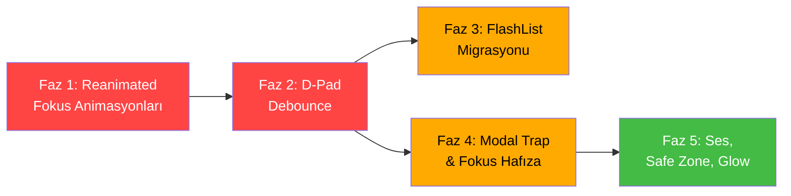

# 🎯 StreamPulse Android TV — Netflix Düzeyinde Fokus & Akıcılık Planı

> [!IMPORTANT]
> Bu plan, mevcut kodunuzun derinlemesine analizine dayanır. Projenizde zaten iyi bir TV altyapısı var (`TVPressable`, `useFocusCentering`, `TVFocusContext`, `useTVRemote`, `tvMetrics`). Aşağıdaki iyileştirmeler mevcut temeli bozmadan üzerine Netflix/Prime Video düzeyine çıkaracak adımlardır.

---

## 📊 Mevcut Durum Analizi

### ✅ Zaten Doğru Yapılanlar
| Bileşen | Durum |
|---|---|
| `TVPressable` — D-Pad OK uzun basma desteği | ✅ |
| `useFocusCentering` — scrollToIndex + viewPosition ortalama | ✅ |
| `TVFocusContext` — Yan ray ↔ içerik arası native tag paylaşımı | ✅ |
| `useTVRemote` — DeviceEventEmitter HW key dinleme | ✅ |
| `getItemLayout` — FlatList sabit ölçüm | ✅ |
| `removeClippedSubviews={false}` — TV'de odak kaybı önleme | ✅ |
| `React.memo` — CategoryCard ve MovieCategorySection | ✅ |
| `useCallback` — renderItem, onPress handler'lar stabil | ✅ |
| `expo-image` — recyclingKey + transition(0) + memory-disk cache | ✅ |
| `tvMetrics` — TV ölçekleme sistemi | ✅ |

### ❌ Eksik/Sorunlu Alanlar (Netflix Farkı)
| Sorun | Etki | Öncelik |
|---|---|---|
| Odak animasyonları JS thread'de (`StyleSheet` ile scale/border) | Her fokus değişiminde JS → Native köprüsü | 🔴 Kritik |
| `onFocus` içinde `setState(isFocused)` — her kart re-render | UI thread bloklanır, kare düşer | 🔴 Kritik |
| `FlatList` yerine `FlashList` kullanılmıyor | Bellek + scroll performansı | 🟡 Yüksek |
| Odak ses efekti yok | Netflix'te her D-pad hareketinde hafif "tık" | 🟢 Orta |
| Hızlı D-pad tutuşunda debounce yok | 10 karttan 10 ayrı scroll tetiklenir | 🔴 Kritik |
| Modal odak tuzağı (focus trap) yok | Modal açıldığında odak arkaya kaçıyor | 🟡 Yüksek |
| Sayfa geçişlerinde odak geri yükleme yok | Geri gelince odak her zaman ilk karta | 🟡 Yüksek |
| Overscan padding (TV safe zone) eksik | İçerik TV kenarında kesilebilir | 🟢 Orta |
| Programmatic fokus yönetimi zayıf | İlk açılışta odak nereye düşeceği belirsiz | 🟡 Yüksek |

---

## 🏗️ Uygulama Planı (5 Faz)

---

### Faz 1: Fokus Animasyonlarını Native Thread'e Taşı (🔴 Kritik)
> Netflix'in akıcılığının %60'ı bu adımdan gelir

#### Sorun
`CategoryCard` ve `TVPressable` odak stilini JS thread'de `useState(isFocused)` + `StyleSheet` ile uyguluyor. D-pad her basışta:
1. `onFocus` → `setIsFocused(true)` → React re-render → bridge → native
2. `onBlur` → `setIsFocused(false)` → React re-render → bridge → native

Bu döngü, hızlı D-pad navigasyonunda **16ms kare bütçesini** aşar.

#### Çözüm
`react-native-reanimated` worklet'leri ile odak animasyonlarını **tamamen UI thread'de** çalıştır.

#### Değişecek Dosyalar
- [TVPressable.jsx](file:///d:/Projeler/ReactNative/StreamPulse/src/components/common/TVPressable.jsx) — `useState(isFocused)` → `useSharedValue` + `useAnimatedStyle`
- [CategoryCard.jsx](file:///d:/Projeler/ReactNative/StreamPulse/src/components/content/CategoryCard.jsx) — `cardFocused` stili → Reanimated `withSpring` scale
- [BottomNavigation.jsx](file:///d:/Projeler/ReactNative/StreamPulse/src/components/BottomNavigation.jsx) — rail ikon fokus scale animasyonu

#### Mimari Değişiklik
```
ÖNCE (JS Thread):
onFocus → setState → re-render → style hesapla → bridge → native draw

SONRA (UI Thread):
onFocus → sharedValue.value = 1 → Reanimated worklet → native draw
                                  (JS thread'e hiç dönmez)
```

#### Detaylı Adımlar

**1.1) `TVPressable` Reanimated Refactor**
```jsx
// ÖNCE: useState ile JS re-render
const [isFocused, setIsFocused] = useState(false);

// SONRA: Reanimated shared value — sıfır re-render
const focusProgress = useSharedValue(0);

const animatedFocusStyle = useAnimatedStyle(() => ({
  transform: [{ scale: withSpring(focusProgress.value ? 1.08 : 1, { damping: 15, stiffness: 150 }) }],
  borderColor: interpolateColor(focusProgress.value, [0, 1], ['transparent', Palette.primary]),
  borderWidth: interpolate(focusProgress.value, [0, 1], [0, 2]),
}));
```

> [!WARNING]
> `children` fonksiyon render pattern (`({focused}) => ...`) Reanimated ile doğrudan uyumsuz. `TVPressable`'ın `children` render prop'u yerine, `Animated.View` wrapper + `useAnimatedStyle` ile odak görselliği sağlanmalı. Mevcut `children({focused})` pattern'i korunabilir ama **sadece görsel olmayan davranışlar** için (ör. ikon adı değiştirme); scale/border/shadow Reanimated'a taşınmalı.

**1.2) `CategoryCard` Native Animasyon**
```jsx
const focusScale = useSharedValue(1);
const focusBorder = useSharedValue(0);

const cardAnimStyle = useAnimatedStyle(() => ({
  transform: [{ scale: withSpring(focusScale.value, FOCUS_SPRING) }],
}));

const posterAnimStyle = useAnimatedStyle(() => ({
  borderWidth: interpolate(focusBorder.value, [0, 1], [1, 3]),
  borderColor: interpolateColor(focusBorder.value, [0, 1], 
    ['rgba(70, 69, 84, 0.6)', Palette.primary]),
}));
```

**1.3) Netflix Tarzı Spring Config**
```js
// Netflix'in fokus animasyonu: hızlı yanıt, minimal salınım
const FOCUS_SPRING = { 
  damping: 18, 
  stiffness: 200, 
  mass: 0.8,
  overshootClamping: false 
};

// Blur animasyonu: biraz daha yavaş, yumuşak geçiş
const BLUR_SPRING = { 
  damping: 22, 
  stiffness: 160, 
  mass: 0.8 
};
```

---

### Faz 2: D-Pad Hızlı Navigasyon Optimizasyonu (🔴 Kritik)

#### Sorun
Kullanıcı D-pad'i basılı tuttuğunda saniyede ~10 odak değişimi olur. Her biri:
- `handleCardFocus(index)` → `scrollToIndex` → animasyonlu scroll
- `onRowFocused()` → dikey `scrollToIndex` → animasyonlu scroll
- İki eksen paralel scroll çakışır, takılma oluşur

#### Çözüm: Akıllı Debounce + İptal Mekanizması

#### Değişecek Dosyalar
- [useFocusCentering.js](file:///d:/Projeler/ReactNative/StreamPulse/src/hooks/useFocusCentering.js) — debounced scroll
- Yeni dosya: `src/hooks/useDebouncedFocus.js`

#### Detaylı Adımlar

**2.1) Scroll Debounce**
```js
// useFocusCentering.js — handleItemFocus'a debounce ekle
const scrollTimerRef = useRef(null);

const handleItemFocus = useCallback((index) => {
  if (!enabled || index == null) return;
  
  // Önceki beklenen scroll'u iptal et
  if (scrollTimerRef.current) clearTimeout(scrollTimerRef.current);
  
  // 80ms bekle — hızlı D-pad'de ara kartlara scroll yapmaz,
  // ama tek basışta kullanıcı gecikmeyi HISSETMEZ
  scrollTimerRef.current = setTimeout(() => {
    scrollTimerRef.current = null;
    scrollRowToCenter(targetIndex);
  }, 80);
}, [/* deps */]);
```

> [!TIP]
> Netflix'in D-pad debounce süresi ~60-100ms arasıdır. 80ms iyi bir denge noktası: insan algısı 100ms'nin altındaki gecikmeyi "anında" olarak algılar ama art arda hızlı basışlarda gereksiz scroll'u önler.

**2.2) Dikey + Yatay Scroll Koordinasyonu**
```js
// Satır odaklanınca: ÖNCE yatay scroll (80ms debounce), 
// SONRA dikey scroll (yatay bittikten 30ms sonra)
const handleCardFocus = useCallback((index) => {
  centerOnScreen(index); // yatay — kendi debounce'u var
  
  // Dikey scroll: yataydan biraz sonra (çakışma önleme)
  if (rowFocusTimerRef.current) clearTimeout(rowFocusTimerRef.current);
  rowFocusTimerRef.current = setTimeout(() => {
    onRowFocused?.();
  }, 110); // 80 + 30ms
}, [centerOnScreen, onRowFocused]);
```

---

### Faz 3: FlatList → FlashList Migrasyonu (🟡 Yüksek)

#### Sorun
React Native `FlatList` her öğeyi ayrı bir `View` hiyerarşisinde oluşturur. Netflix/Prime gibi uygulamalar **RecyclerView** (Android native) veya eşdeğeri kullanır — hücre geri dönüşüm havuzu ile.

#### Çözüm
`@shopify/flash-list` — FlatList'in drop-in replacement'ı, native RecyclerView tabanlı.

#### Değişecek Dosyalar
- [MovieCategorySection.jsx](file:///d:/Projeler/ReactNative/StreamPulse/src/components/home/MovieCategorySection.jsx) — yatay satır
- [index.jsx](file:///d:/Projeler/ReactNative/StreamPulse/src/app/(app)/index.jsx) — ana sayfa dikey liste
- [category.jsx](file:///d:/Projeler/ReactNative/StreamPulse/src/app/(app)/category.jsx) — kategori ızgara
- [ContinueWatchingSection.jsx](file:///d:/Projeler/ReactNative/StreamPulse/src/components/home/ContinueWatchingSection.jsx)
- [SeasonsSection.jsx](file:///d:/Projeler/ReactNative/StreamPulse/src/components/MovieDetailComponents/SeasonsSection.jsx)

#### Kurulum
```bash
bunx expo install @shopify/flash-list
```

#### Dikkat Edilecekler

> [!CAUTION]
> FlashList TV'de dikkatli kullanılmalı:
> - `estimatedItemSize` **ZORUNLU** — `getItemLayout` yerine geçer
> - `removeClippedSubviews` FlashList'te zaten native kontrollü, prop'u KALDIRIN
> - `overrideItemLayout` ile sabit boyut verirseniz ölçüm atlaması otomatik
> - `drawDistance` parametresi TV'de `500`-`800` arası olmalı — çok düşük olursa hızlı scroll'da boş kart görünür

#### Migrasyon Şablonu
```jsx
// ÖNCE
import { FlatList } from 'react-native';
<FlatList
  data={rowData}
  getItemLayout={getItemLayout}
  removeClippedSubviews={!Platform.isTV}
  windowSize={7}
  ...
/>

// SONRA
import { FlashList } from '@shopify/flash-list';
<FlashList
  data={rowData}
  estimatedItemSize={CARD_STRIDE}
  drawDistance={Platform.isTV ? 600 : 250}
  overrideItemLayout={(layout) => {
    layout.size = CARD_STRIDE;
  }}
  ...
/>
```

> [!NOTE]
> FlashList TV uyumluluğu test edilmeli. Eğer `FlashList` TV'de fokus sorunları çıkarırsa, **Faz 1 ve 2 tek başına** büyük fark yaratır — FlashList opsiyonel tutulabilir.

---

### Faz 4: Modal Fokus Tuzağı & Sayfa Geçiş Fokus Yönetimi (🟡 Yüksek)

#### Sorun
- Modal/Bottom Sheet açıldığında odak arkadaki kartlara kaçabiliyor
- Bir ekrandan geri dönüldüğünde odak her zaman sıfırdan başlıyor

#### Değişecek Dosyalar
- [Bottomsheetmodal.jsx](file:///d:/Projeler/ReactNative/StreamPulse/src/components/modal/Bottomsheetmodal.jsx) — focus trap
- [QuickPreviewModal.jsx](file:///d:/Projeler/ReactNative/StreamPulse/src/components/modal/QuickPreviewModal.jsx) — focus trap
- [ActionMenuModal.jsx](file:///d:/Projeler/ReactNative/StreamPulse/src/components/modal/ActionMenuModal.jsx) — focus trap
- Yeni dosya: `src/hooks/useTVFocusRestore.js` — geri dönüşte odak hafızası
- Yeni dosya: `src/components/common/TVFocusTrap.jsx` — modal odak tuzağı

#### Detaylı Adımlar

**4.1) `TVFocusTrap` — Modal Odak Tuzağı**
```jsx
/**
 * Modal/overlay açıldığında odağı içinde tutar.
 * Kapandığında eski odağa geri döner.
 * 
 * Android TV'de native "window focus" kavramı yok — RN tarafında
 * backdrop'u focusable=false yapıp, içerik alanının ilk öğesine
 * hasTVPreferredFocus vermek gerekir.
 */
function TVFocusTrap({ active, children }) {
  // active=true olduğunda:
  // 1. Arkadaki tüm focusable öğeleri devre dışı bırak
  // 2. İçerideki ilk öğeye hasTVPreferredFocus ver
  // active=false olduğunda:
  // 1. Eski odak hedefine geri dön
}
```

**4.2) Sayfa Geçişlerinde Odak Hafızası**
```js
// useTVFocusRestore.js
export function useTVFocusRestore(screenKey) {
  const lastFocusedRef = useRef(null);
  
  // Ekrandan ayrılırken son odaklanan öğeyi kaydet
  const saveFocus = useCallback((nativeTag) => {
    lastFocusedRef.current = nativeTag;
  }, []);
  
  // Ekrana geri dönünce odağı geri yükle
  useFocusEffect(useCallback(() => {
    if (Platform.isTV && lastFocusedRef.current) {
      // Native tag'e programmatic odak ver
      UIManager.dispatchViewManagerCommand(
        lastFocusedRef.current,
        'requestTVFocus', // veya setNativeProps
        []
      );
    }
  }, []));
  
  return { saveFocus };
}
```

---

### Faz 5: Cilalama & Netflix Detayları (🟢 Orta)

#### 5.1) Odak Ses Efekti
Netflix ve Prime Video'da D-pad'le gezinirken hafif bir "tık" sesi çalar. Bu, kullanıcıya dokunsal geri bildirim yerine işitsel geri bildirim verir.

#### Değişecek Dosyalar
- [TVPressable.jsx](file:///d:/Projeler/ReactNative/StreamPulse/src/components/common/TVPressable.jsx) — `onFocus`'ta ses çal

```js
// TV'de odak değişiminde hafif ses
import { Platform } from 'react-native';
// expo-av veya react-native-sound ile kısa .wav dosyası
const FOCUS_SOUND_ENABLED = Platform.isTV;
```

#### 5.2) Overscan/Safe Zone Padding
TV'lerin kenar kırpma alanı (overscan) için %5 güvenli alan:

```js
// tvMetrics.js'e ekle
const TV_SAFE_AREA_PERCENT = 0.03; // %3 her kenardan
export const tvSafeArea = Platform.isTV ? {
  paddingTop: screenH * TV_SAFE_AREA_PERCENT,
  paddingBottom: screenH * TV_SAFE_AREA_PERCENT,
  paddingLeft: screenW * TV_SAFE_AREA_PERCENT,
  paddingRight: screenW * TV_SAFE_AREA_PERCENT,
} : {};
```

#### 5.3) Odak Görsel İyileştirme
Netflix tarzı "glow" efekti — sadece odaklanan karta hafif ışıma:

```jsx
// posterFocused stiline ekleme
posterFocused: {
  borderColor: Palette.primary,
  borderWidth: 3,
  // Netflix glow efekti — GPU'da ucuz
  shadowColor: Palette.primary,
  shadowOffset: { width: 0, height: 0 },
  shadowOpacity: 0.6,
  shadowRadius: 16,
  elevation: 8,
},
```

> [!NOTE]
> `elevation` değişimi **Faz 1'de Reanimated'a taşınmalı**. Statik `StyleSheet` ile elevation değiştirmek Android'de outline rasterize eder — Reanimated worklet'te `elevation` interpolasyonu bu maliyeti ortadan kaldırır.

#### 5.4) Hero Banner İlk Fokus
Sayfa açıldığında odağın hero'nun "Oynat" butonuna düşmesi:

```jsx
<TVPressable
  autoFocus={Platform.isTV}
  // veya
  hasTVPreferredFocus={Platform.isTV}
>
  Oynat
</TVPressable>
```

---

## 📋 Uygulama Sırası & Tahmini Etki



| Faz | Süre | Akıcılık Etkisi | Zorluk |
|-----|------|-----------------|--------|
| **Faz 1** — Reanimated fokus | 2-3 gün | ⬆️⬆️⬆️⬆️⬆️ | Orta |
| **Faz 2** — D-pad debounce | 0.5-1 gün | ⬆️⬆️⬆️⬆️ | Kolay |
| **Faz 3** — FlashList | 1-2 gün | ⬆️⬆️⬆️ | Orta (test ağır) |
| **Faz 4** — Modal trap + fokus hafıza | 1-2 gün | ⬆️⬆️⬆️ | Orta |
| **Faz 5** — Cilalama | 1 gün | ⬆️⬆️ | Kolay |

---

## ⚡ Hızlı Kazanımlar (Bugün Yapılabilir)

Hiçbir yapısal değişiklik yapmadan, sadece parametreleri ayarlayarak hemen elde edilecek kazanımlar:

1. **`useFocusCentering`'e 80ms debounce ekle** — ~10 satır değişiklik
2. **`CategoryCard` `cardFocused` stilinden `elevation: 6` kaldır** — elevation değişimi pahalı, shadow yeter
3. **Ana sayfa FlatList `initialNumToRender` → 3 yap** (şu an 2, hero dahil 3 satır ilk ekrana sığıyor)
4. **`windowSize` → 5 yap** (şu an 3, hızlı scroll'da boş görünüyor)

---

## 🧪 Test Stratejisi

> [!IMPORTANT]
> **Düşük donanımlı cihazda test edin!** Netflix bile en düşük Android TV stick'lerde (1GB RAM, mali GPU) sorunsuz çalışacak şekilde optimize edilir. Mi TV Stick, Fire TV Stick Lite gibi cihazlarda test etmek şarttır.

### Test Senaryoları
1. ✅ D-pad'i basılı tutarak 20+ kart arası hızlı geçiş — kare düşmesi olmamalı
2. ✅ Satırlar arası dikey geçiş — scroll akıcı, atlama olmamalı
3. ✅ Modal açıp kapanınca — odak eski konumuna dönmeli
4. ✅ Geri tuşu ile sayfa geçişi — son odaklanan karta dönmeli
5. ✅ Sol ray ↔ içerik geçişi — her yükseklikten çalışmalı (mevcut SORUN 3 çözümü)
6. ✅ Hero banner → ilk kategori satırı → sol ray — üçgen navigasyon
