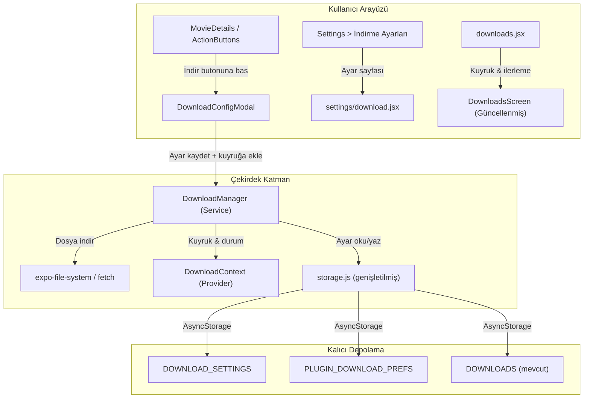
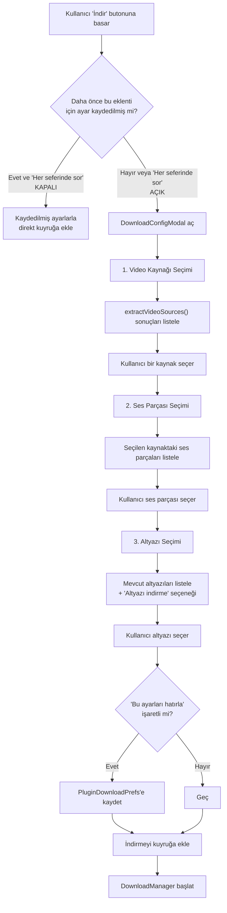

# 📥 StreamPulse — İndirme Özelliği Planı

## Genel Bakış

StreamPulse uygulamasına tam kapsamlı bir indirme sistemi eklenmesi planıdır. Sistem; eklenti bazlı indirme tercihleri, indirme öncesi kaynak seçim modalı, kuyruk yönetimi, eş zamanlılık kontrolü ve dosya isimlendirme kurallarını kapsar.

---

## 1. Mimari Genel Şema



---

## 2. Veri Modelleri

### 2.1 Genel İndirme Ayarları (`DOWNLOAD_SETTINGS`)

```js
// storage.js — STORAGE_KEYS.DOWNLOAD_SETTINGS = "app_download_settings"
const DEFAULT_DOWNLOAD_SETTINGS = {
  // Eş zamanlı indirme sayısı (sıradan kaç tanesi aynı anda indirilecek)
  maxConcurrentDownloads: 2,        // 1-5 arası
  // Eş zamanlı bağlantı sayısı (tek dosya için paralel parça sayısı)
  maxConnectionsPerDownload: 4,     // 1-8 arası
  // İndirme konumu (varsayılan: İndirilenler/StreamPulse)
  downloadPath: "Downloads/StreamPulse",
  // Her indirmede onay modal'ı gösterilsin mi?
  alwaysAskBeforeDownload: true,
};
```

### 2.2 Eklenti Başına İndirme Tercihleri (`PLUGIN_DOWNLOAD_PREFS`)

```js
// storage.js — STORAGE_KEYS.PLUGIN_DOWNLOAD_PREFS = "app_plugin_download_prefs"
// Anahtar: pluginName (eklenti adı)
// Değer: o eklentiye özel tercihler
const PLUGIN_DOWNLOAD_PREFS_EXAMPLE = {
  "dizipal": {
    preferredSource: "RapidVid",        // tercih edilen video kaynağı (extractor)
    preferredAudioTrack: "tr",          // tercih edilen ses parçası (dil kodu)
    preferredSubtitle: "tr",            // tercih edilen altyazı (dil kodu)
    downloadSubtitle: true,             // altyazı indirilsin mi?
    alwaysAsk: false,                   // her seferinde sor (false = direkt kayıtlı ayarla indir)
  },
  "filmizle": {
    preferredSource: "CloseLoad",
    preferredAudioTrack: "en",
    preferredSubtitle: "tr",
    downloadSubtitle: true,
    alwaysAsk: true,
  },
};
```

### 2.3 İndirme Kuyruğu Öğesi (Mevcut `DOWNLOADS` listesinin genişletilmesi)

```js
const DOWNLOAD_ITEM = {
  id: "unique-download-id",                       // UUID
  contentId: "movie-or-episode-id",                // İçeriğin benzersiz kimliği
  contentTitle: "Film veya Dizi Adı",              // Görüntüleme adı
  pluginName: "dizipal",                           // Hangi eklentiden
  type: "movie" | "series",                        // Film mi dizi mi
  // Dizi ise:
  seriesTitle: "Dizi Adı",
  seasonNumber: 1,
  episodeNumber: 4,
  episodeTitle: "Bölüm Başlığı",                   // varsa
  // İndirme detayları:
  sourceUrl: "https://...",                         // indirilen stream URL
  sourceName: "RapidVid",                           // extractor adı
  audioTrack: "tr",
  subtitleUrl: "https://...",                        // altyazı URL (varsa)
  subtitleLang: "tr",
  // Durum:
  status: "queued" | "downloading" | "paused" | "completed" | "failed" | "cancelled",
  progress: 0.0,                                    // 0.0 - 1.0
  downloadedBytes: 0,
  totalBytes: 0,
  filePath: "Downloads/StreamPulse/DiziAdı/DiziAdı-S01xE04-BölümBaşlığı.mp4",
  subtitlePath: "Downloads/StreamPulse/DiziAdı/DiziAdı-S01xE04-BölümBaşlığı.srt",
  // Kısmi dosya (resume için):
  tempFilePath: ".../.downloads_temp/uuid.part",     // indirme tamamlanana kadar geçici dosya
  resumable: true,                                   // sunucu HTTP Range destekliyor mu?
  lastResumeOffset: 0,                               // son kaldığı byte offset
  retryCount: 0,                                     // otomatik yeniden deneme sayacı
  maxRetries: 3,                                     // max otomatik yeniden deneme
  // Zaman damgaları:
  createdAt: "2026-10-23T20:00:00Z",
  pausedAt: null,                                    // en son duraklatılma zamanı
  completedAt: null,
  error: null,
  errorCode: null,                                   // "NETWORK_LOST" | "DISK_FULL" | "HTTP_ERROR" | ...
  // Poster (gösterim için)
  posterUrl: "https://...",
};
```

---

## 3. Dosya İsimlendirme Kuralları

### 3.1 Klasör Yapısı

```
İndirilenler/
└── StreamPulse/
    ├── Breaking Bad/                          ← Dizi klasörü
    │   ├── Breaking Bad-S01xE01-Pilot.mp4
    │   ├── Breaking Bad-S01xE01-Pilot.srt
    │   ├── Breaking Bad-S01xE02-Cat's in the Bag.mp4
    │   └── Breaking Bad-S01xE02-Cat's in the Bag.srt
    ├── Inception/                              ← Film klasörü
    │   ├── Inception.mp4
    │   └── Inception.srt
    └── Dark/
        └── Dark-S02xE05.mp4                   ← Bölüm ismi yoksa
```

### 3.2 İsimlendirme Formülleri

| Tür | Format | Örnek |
|-----|--------|-------|
| **Film** | `{FilmAdı}.{uzantı}` | `Inception.mp4` |
| **Dizi (bölüm isimli)** | `{DiziAdı}-S{SS}xE{BB}-{BölümAdı}.{uzantı}` | `Breaking Bad-S01xE01-Pilot.mp4` |
| **Dizi (bölüm isimsiz)** | `{DiziAdı}-S{SS}xE{BB}.{uzantı}` | `Dark-S02xE05.mp4` |

> **Sezon / Bölüm numarası** her zaman iki haneli (zero-pad): `S01`, `E04`

### 3.3 Dosya Adı Sanitizasyon

```js
function sanitizeFileName(name) {
  return name
    .replace(/[<>:"/\\|?*]/g, '')     // Geçersiz dosya sistem karakterleri
    .replace(/\s+/g, ' ')             // Çoklu boşlukları tek boşluğa
    .trim();
}
```

---

## 4. Oluşturulacak / Değiştirilecek Dosyalar

### Faz 1: Altyapı (Storage + Manager)

| # | Dosya | İşlem | Açıklama |
|---|-------|-------|----------|
| 1 | [`src/utils/storage.js`](file:///D:/Projeler/ReactNative/StreamPulse/src/utils/storage.js) | **Değiştir** | Yeni `STORAGE_KEYS` ekle: `DOWNLOAD_SETTINGS`, `PLUGIN_DOWNLOAD_PREFS`. Yeni CRUD fonksiyonları: `getDownloadSettings()`, `saveDownloadSettings()`, `getPluginDownloadPrefs()`, `savePluginDownloadPref()`, `resetDownloadSettings()` |
| 2 | `src/services/downloadManager.js` | **Yeni** | İndirme kuyruğu yöneticisi. Eş zamanlılık kontrolü, ilerleme takibi, dosya sistemi işlemleri (`expo-file-system`), duraklatma/devam/iptal. |
| 3 | `src/context/DownloadContext.jsx` | **Yeni** | `DownloadProvider` + `useDownload()` hook. Uygulama genelinde indirme durumunu paylaşır (aktif indirmeler, kuyruk, ilerleme). |

### Faz 2: İndirme Öncesi Modal

| # | Dosya | İşlem | Açıklama |
|---|-------|-------|----------|
| 4 | `src/components/download/DownloadConfigModal.jsx` | **Yeni** | İndirme öncesi açılan modal. Video kaynağı, ses parçası, altyazı seçimi. "Bu ayarları hatırla" seçeneği. |

### Faz 3: Ayarlar Sayfası

| # | Dosya | İşlem | Açıklama |
|---|-------|-------|----------|
| 5 | `src/app/(app)/settings/download.jsx` | **Yeni** | İndirme ayarları sayfası. Genel ayarlar (eş zamanlı indirme, bağlantı sayısı, konum) + eklenti bazlı tercihler listesi. |
| 6 | [`src/app/(app)/settings/index.jsx`](file:///D:/Projeler/ReactNative/StreamPulse/src/app/(app)/settings/index.jsx) | **Değiştir** | "OYNATMA VE GÖRÜNÜM" kategorisine yeni `SettingRow` ekle: "İndirme" girişi → `settings/download` sayfasına yönlendir. |

### Faz 4: İndirme Ekranı Güncelleme

| # | Dosya | İşlem | Açıklama |
|---|-------|-------|----------|
| 7 | [`src/app/(app)/downloads.jsx`](file:///D:/Projeler/ReactNative/StreamPulse/src/app/(app)/downloads.jsx) | **Değiştir** | Mevcut boş/placeholder ekranı gerçek indirme listesiyle değiştir. İlerleme çubuğu, duraklatma/devam/iptal butonları, durum göstergesi. |

### Faz 5: Tetikleyici Entegrasyonu

| # | Dosya | İşlem | Açıklama |
|---|-------|-------|----------|
| 8 | [`src/components/MovieDetailComponents/ActionButtons.jsx`](file:///D:/Projeler/ReactNative/StreamPulse/src/components/MovieDetailComponents/ActionButtons.jsx) | **Değiştir** | "İndir" butonuna basıldığında `DownloadConfigModal`'ı aç. |
| 9 | [`src/app/_layout.jsx`](file:///D:/Projeler/ReactNative/StreamPulse/src/app/_layout.jsx) | **Değiştir** | `DownloadProvider`'ı kök layout'a sar. |

---

## 5. `DownloadConfigModal` — Detaylı Akış



### Modal UI Yapısı

```
┌──────────────────────────────────────┐
│  ✕                İndirme Ayarları   │
├──────────────────────────────────────┤
│                                      │
│  📹 Video Kaynağı                    │
│  ┌────────────────────────────────┐  │
│  │ ● RapidVid        (1080p)     │  │
│  │ ○ CloseLoad       (720p)      │  │
│  │ ○ VidMoly         (480p)      │  │
│  └────────────────────────────────┘  │
│                                      │
│  🔊 Ses Parçası                      │
│  ┌────────────────────────────────┐  │
│  │ ● Türkçe Dublaj               │  │
│  │ ○ İngilizce (Orijinal)        │  │
│  └────────────────────────────────┘  │
│                                      │
│  📝 Altyazı                          │
│  ┌────────────────────────────────┐  │
│  │ ● Türkçe                      │  │
│  │ ○ İngilizce                   │  │
│  │ ○ Altyazı İndirme             │  │
│  └────────────────────────────────┘  │
│                                      │
│  ☑ Bu eklenti için ayarları hatırla  │
│  ☐ Her seferinde sor                 │
│                                      │
│  ┌────────────────────────────────┐  │
│  │         İndirmeyi Başlat       │  │
│  └────────────────────────────────┘  │
└──────────────────────────────────────┘
```

---

## 6. `DownloadManager` — Servis Tasarımı

### 6.1 Sorumluluklar

| Sorumluluk | Açıklama |
|------------|----------|
| **Kuyruk yönetimi** | FIFO sırasıyla indirmeleri yönet. `maxConcurrentDownloads` sınırına göre bekleme/başlatma. |
| **Eş zamanlılık** | Aynı anda en fazla N indirme çalışır. Bir indirme bitince kuyruktan sonraki başlar. |
| **İlerleme takibi** | Her indirmenin `progress`, `downloadedBytes`, `totalBytes` değerlerini gerçek zamanlı güncelle. |
| **Dosya sistemi** | `expo-file-system` ile klasör oluşturma, dosya yazma, isimlendirme kurallarını uygulama. |
| **Duraklatma/Devam** | İndirmeyi durdur, resume edebilir (HTTP Range desteği varsa). |
| **Hata yönetimi** | Bağlantı kopma, disk dolu, izin hatası durumlarını yakala ve kullanıcıya bildir. |
| **HLS/M3U8 desteği** | HLS stream'leri segment-segment indirip birleştir veya FFmpeg ile dönüştür. |

### 6.2 API

```js
// downloadManager.js
export const DownloadManager = {
  // Kuyruğa ekle
  enqueue(downloadItem: DownloadItem): Promise<string>,
  
  // Kuyruğu başlat (oto-başlar, ama explicit çağrı da olabilir)
  start(): void,
  
  // Belirli bir indirmeyi duraklat
  pause(downloadId: string): void,
  
  // Duraklatılmış indirmeyi devam ettir
  resume(downloadId: string): void,
  
  // İndirmeyi iptal et ve kısmi dosyayı sil
  cancel(downloadId: string): Promise<void>,
  
  // Tüm aktif indirmeleri durdur
  pauseAll(): void,
  
  // Tüm bekleyenleri devam ettir
  resumeAll(): void,
  
  // İndirme durumunu dinle
  onProgress(callback: (downloadId, progress) => void): Unsubscribe,
  onStatusChange(callback: (downloadId, status) => void): Unsubscribe,
};
```

---

## 7. Ayarlar Sayfası — `settings/download.jsx`

### Sayfa Düzeni

```
┌───────────────────────────────────────┐
│  ←  İndirme Ayarları                  │
├───────────────────────────────────────┤
│                                       │
│  GENEL                                │
│  ┌─────────────────────────────────┐  │
│  │ 🔽 Eş Zamanlı İndirme      2   │  │
│  │────────────────────────────────-│  │
│  │ 🔗 Eş Zamanlı Bağlantı     4   │  │
│  │────────────────────────────────-│  │
│  │ 📂 İndirme Konumu              │  │
│  │    İndirilenler/StreamPulse  >  │  │
│  │────────────────────────────────-│  │
│  │ ❓ Her Defasında Sor    [ON]    │  │
│  └─────────────────────────────────┘  │
│                                       │
│  EKLENTİ İNDİRME TERCİHLERİ          │
│  ┌─────────────────────────────────┐  │
│  │ 🧩 dizipal                  >   │  │
│  │    Kaynak: RapidVid              │  │
│  │────────────────────────────────-│  │
│  │ 🧩 filmizle                 >   │  │
│  │    Kaynak: CloseLoad             │  │
│  │────────────────────────────────-│  │
│  │ 🧩 hdfilmcehennemi          >   │  │
│  │    Ayar yapılmadı                │  │
│  └─────────────────────────────────┘  │
│                                       │
│  ┌─────────────────────────────────┐  │
│  │  🗑 Tüm Tercihleri Sıfırla     │  │
│  └─────────────────────────────────┘  │
└───────────────────────────────────────┘
```

### Eklenti Detay Modalı (satıra dokunulunca)

Her eklenti satırına dokunulduğunda bir modal/sayfa açılır:

- **Tercih edilen kaynak** (dropdown — son kullanılan kaynaklar veya "Otomatik")
- **Tercih edilen ses parçası** (dropdown — dil kodları)
- **Tercih edilen altyazı** (dropdown — dil kodları + "İndirme")
- **Her seferinde sor** (Switch)
- **Sıfırla** butonu

---

## 8. Settings Ana Sayfasına Entegrasyon

[`settings/index.jsx`](file:///D:/Projeler/ReactNative/StreamPulse/src/app/(app)/settings/index.jsx) dosyasında **"OYNATMA VE GÖRÜNÜM"** kategorisine (L501, "Oynatıcı" satırından sonra) yeni bir giriş eklenir:

```jsx
{/* İndirme */}
<SettingRow
  icon="download-outline"
  iconBg="#06B6D4"
  label="İndirme"
  subtitle="Eş zamanlı indirme, konum ve eklenti tercihleri"
  onPress={() =>
    router.push({
      pathname: "/(app)/settings/download",
    })
  }
/>
```

---

## 9. `DownloadContext` Tasarımı

```jsx
// src/context/DownloadContext.jsx
const DownloadContext = createContext();

export function DownloadProvider({ children }) {
  const [queue, setQueue] = useState([]);           // Tüm indirme öğeleri
  const [activeDownloads, setActiveDownloads] = useState([]); // Aktif indirilenler
  const [settings, setSettings] = useState(DEFAULT_DOWNLOAD_SETTINGS);

  // DownloadManager event listener'ları burada bağlanır
  // progress, statusChange callback'leri state'i günceller

  return (
    <DownloadContext.Provider value={{
      queue,
      activeDownloads,
      settings,
      enqueueDownload,
      pauseDownload,
      resumeDownload,
      cancelDownload,
      updateSettings,
    }}>
      {children}
    </DownloadContext.Provider>
  );
}

export const useDownload = () => useContext(DownloadContext);
```

---

## 10. Uygulama Sırası (İmplementasyon Fazları)

### Faz 1 — Altyapı (Storage + Manager) 🏗️

1. `storage.js`'e yeni STORAGE_KEYS ve CRUD fonksiyonları ekle
2. `downloadManager.js` servisini oluştur
3. `DownloadContext.jsx` provider'ını oluştur
4. `_layout.jsx`'e `DownloadProvider` sar

### Faz 2 — İndirme Öncesi Modal 🎯

5. `DownloadConfigModal.jsx` oluştur
6. `ActionButtons.jsx`'e indirme tetikleyicisini entegre et
7. Modal'ın `extractVideoSources()` ile kaynak listesini çekmesini sağla

### Faz 3 — Ayarlar Sayfası ⚙️

8. `settings/download.jsx` sayfasını oluştur
9. `settings/index.jsx`'e "İndirme" girişini ekle

### Faz 4 — İndirme Ekranı 📋

10. `downloads.jsx`'i gerçek kuyruk/ilerleme UI'ı ile güncelle

### Faz 5 — İleri Özellikler (İsteğe Bağlı) 🚀

11. HLS/M3U8 stream indirme desteği
12. Arka planda indirme (expo-task-manager)
13. İndirme bildirimleri
14. İndirilen içeriği çevrimdışı oynatma

---

## 11. Bağımlılıklar

| Paket | Amaç | Durum |
|-------|-------|-------|
| `expo-file-system` | Dosya yazma/okuma, klasör oluşturma | ✅ Muhtemelen zaten yüklü |
| `expo-media-library` | İndirme konumu erişimi (opsiyonel) | 📦 Gerekebilir |
| `uuid` veya `expo-crypto` | İndirme ID üretimi | 📦 Gerekebilir |

> [!IMPORTANT]
> HLS/M3U8 stream'lerin indirilmesi karmaşık bir konudur. İlk fazda sadece doğrudan MP4 URL'lerinin indirilmesi desteklenecek; HLS desteği ayrı bir çalışma olarak planlanabilir.

---

## 12. Kısıtlar ve Dikkat Edilecekler

- **Android izinleri**: Android 10+ için `MANAGE_EXTERNAL_STORAGE` veya Scoped Storage (MediaStore) kullanılmalı.
- **iOS**: Dosyalar uygulama sandbox'ında saklanır; "İndirilenler" klasörüne doğrudan yazılamaz. `documentDirectory` kullanılacak.
- **Disk alanı kontrolü**: İndirme başlamadan önce yeterli alan kontrolü yapılmalı.
- **Ağ durumu**: Wi-Fi/mobil veri tercihi eklenebilir (ileriki faz).
- **Mevcut `DOWNLOADS` storage key'i**: Mevcut yapıyla geriye uyumlu olmalı; migration gerekebilir.
